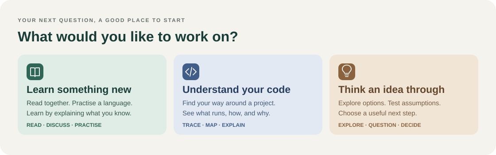

<h1 align="center">SkillShelf</h1>
<p align="center"><strong>Learn something. Understand your code. Think an idea through.</strong></p>
<p align="center">17 skills that give your coding agent a useful way to help.</p>
<p align="center">
  <a href="#find-your-skill">Find a skill</a> ·
  <a href="#get-started">Get started</a> ·
  <a href="docs/examples.md">Things to try</a>
</p>



Read a book with someone to discuss it with. Trace what happens inside an unfamiliar project. Practise an interview. Explain a topic and find the gaps in your understanding.

**Pick a skill, tell your agent what you want to do, and work through it together.** Each skill provides instructions and, where useful, small tools to support the task.

## Find your skill

### Learn and practise

| Skill | Use it to… |
| --- | --- |
| [interviewer-agent](skills/interviewer-agent/SKILL.md) | Practise an interview for your role or project and get feedback on your answers. |
| [language-tutor](skills/language-tutor/SKILL.md) | Learn to speak a language through guided lessons, conversation, and review. |
| [personal-context](skills/personal-context/SKILL.md) | Keep your goals and preferences available across sessions, with changes you approve. |
| [reading-agent](skills/reading-agent/SKILL.md) | Read a book or PDF together, discuss each part, and save where you stopped. |
| [student-agent](skills/student-agent/SKILL.md) | Check your understanding by teaching a curious student who asks about gaps. |
| [tutor-codebase](skills/tutor-codebase/SKILL.md) | Learn software engineering by exploring real code, with saved lessons and practice. |
| [tutor-source-grounded](skills/tutor-source-grounded/SKILL.md) | Study a subject using sources you choose, with a course plan, lessons, and tests. |

### Find your way around code

| Skill | Use it to… |
| --- | --- |
| [code-concept-map](skills/code-concept-map/SKILL.md) | See which programming concepts a project uses in an interactive map. |
| [code-execution-path](skills/code-execution-path/SKILL.md) | Follow a request or action through the code, step by step. |
| [structure-map](skills/structure-map/SKILL.md) | Get an overview of a code library: its main parts, how they connect, and where to start. |
| [tutor-code-file](skills/tutor-code-file/SKILL.md) | Understand what a code file does, how it works, and which parts matter. |
| [tutor-plain-language](skills/tutor-plain-language/SKILL.md) | Get a clear explanation of code or text, with small examples you can follow. |
| [tutor-visual](skills/tutor-visual/SKILL.md) | Understand code and systems through diagrams that show how the pieces work together. |

### Write code

| Skill | Use it to… |
| --- | --- |
| [auto-complete](skills/auto-complete/SKILL.md) | Turn rough notes, pseudocode, or broken code into a working program. |

### Think things through

| Skill | Use it to… |
| --- | --- |
| [brainstorming-agent](skills/brainstorming-agent/SKILL.md) | Talk through an idea, compare your options, and decide what to try next. |
| [idea-council-agent](skills/idea-council-agent/SKILL.md) | Test a project idea from four angles: purpose, demand, cost, and how to build it. |
| [self-help-agent](skills/self-help-agent/SKILL.md) | Talk through difficult feelings or recurring frustrations and explore ways to cope. |

Not sure where to start? Try **[tutor-plain-language](skills/tutor-plain-language/SKILL.md)** for a clear explanation, **[reading-agent](skills/reading-agent/SKILL.md)** for a book, or **[brainstorming-agent](skills/brainstorming-agent/SKILL.md)** for an idea.

## Get started

You'll need a coding agent and Python 3.9+ for the installer. SkillShelf is prepared for Codex; other agents may use the instructions, but their compatibility has not been verified.

### 1. Install a skill

Clone the collection into a location you will keep:

```bash
git clone https://github.com/yati989/skillshelf.git
cd skillshelf
python3 scripts/install.py tutor-plain-language
```

This copies the skill into `~/.agents/skills`. Required companion skills are included automatically. Existing skill folders are kept intact; if a name is already installed, the installer stops and tells you.

### 2. Ask your agent to use it

Restart or reload your agent, then try:

```text
Use $tutor-plain-language to explain this function with a tiny example.
```

Replace the skill name and request with whatever you want to work on. [See an example for every skill →](docs/examples.md)

### 3. Add more when you need them

```bash
python3 scripts/install.py --list
python3 scripts/install.py student-agent code-execution-path
```

To install the whole collection, use `python3 scripts/install.py --all`.

Some learning skills use the included Python tools to save sources, reading progress, and lessons. Keep this checkout available after installing them. The structured course tutor and PDF support need additional setup; the installer does not install Python packages. [Setup and requirements →](docs/setup.md)

## How the skills work

A skill gives your agent a repeatable way to help with a particular task. Your agent supplies the conversation, reasoning, and available tools. A skill does not add browsing, voice, or other capabilities your agent does not already have.

You choose when to start a workflow. Learning skills keep track of where you are, and personal-context changes require your approval. Save your books, notes, and learning records in your own private workspace.

## Also building your career?

Try **[Job Atlas](https://github.com/yati989/job-atlas)** for job hunting: find opportunities, research companies, tailor your resume, and prepare for interviews.

## For contributors

```text
skills/       Skill instructions and supporting tools
runtime/      Python tools for reading and learning records
scripts/      Installation and validation
catalog.json  Skill descriptions and dependencies
docs/         Setup and examples
```

To check a change:

```bash
python3 scripts/validate.py
python3 -m unittest discover -s tests -v
cd runtime
PYTHONDONTWRITEBYTECODE=1 PYTHONPATH=src python3 -m unittest discover -s tests -v
```

## License

[MIT](LICENSE). Books and other sources you supply retain their own licenses.
